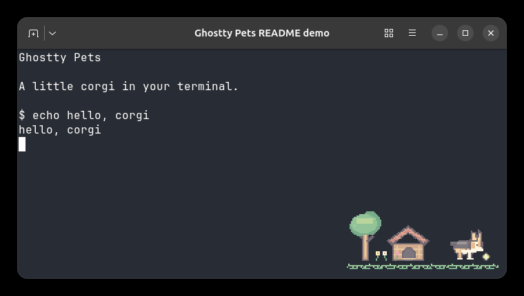

# Ghostty Pets 🐕

**A pixel-art corgi and backyard living inside your Ghostty terminal.** One self-contained GLSL shader draws the scene over the terminal without a daemon, plugin, installer, or runtime image files.



*Actual Ghostty capture of the medium preset on Linux. The terminal text was scripted for the demo; [capture details](docs/evidence/release/CAPTURE.md).*

**Release status:** All five milestones are approved. Linux Ghostty shader loading and user-reported behavior have been checked; macOS/Metal is **not yet tested**. See the [M5 evidence report](docs/M5_REPORT.md) for the exact limits.

## Try it

From the repository root on Linux, open a Ghostty window with the medium shader:

```sh
ghostty --config-default-files=false --custom-shader="$(realpath dist/corgi-backyard-medium.glsl)" --custom-shader-animation=true
```

Ghostty's [configuration options](https://ghostty.org/docs/config/reference) also work as command-line flags. This preview leaves your config file alone.

## Install manually

1. Choose one standalone shader: [small](dist/corgi-backyard-small.glsl), [medium](dist/corgi-backyard-medium.glsl), or [large](dist/corgi-backyard-large.glsl). Medium is the starting choice.
2. Copy it to a directory you control, such as `~/.config/ghostty/shaders/` on Linux. Open your Ghostty config and add the **absolute path** to that copy:

   ```ini
   custom-shader = /absolute/path/to/corgi-backyard-medium.glsl
   custom-shader-animation = true
   ```

3. Reload Ghostty or restart it. Switch presets by changing the path. To disable Ghostty Pets or recover from a bad shader, remove the `custom-shader` line and reload/restart.

The [installation and recovery guide](docs/M5_RELEASE.md) gives Linux and macOS config locations, reload keys, source build steps, and troubleshooting. Python and Pillow are needed only to build shaders from editable source.

## What it does

| Feature | Behavior |
|---|---|
| Animated corgi | Complete, time-driven activities including walking, play, rest, and sleep. Typing does not reset the animation. |
| Living backyard | Transparent grass, tree, doghouse, flowers, butterfly, falling leaf, and a ball synchronized with play. |
| Readability | Nearby terminal-cursor and likely-text regions fade locally. Text detection is heuristic, not guaranteed. |
| Responsive presets | Each file caps the integer pixel scale at 1×, 2×, or 3×. Small panes fall back to a smaller complete scene, a stationary corgi, then no overlay. |
| Per-pane focus | Unfocused panes select an upright doze when Ghostty redraws them; they may keep an earlier frame until then. |

## Build from source

The source art is editable PNG; pet animations and the backyard are defined by validated JSON metadata. The Python builder produces all three standalone release files reproducibly:

```sh
python3 -m venv .venv
.venv/bin/python -m pip install -r requirements-build.txt
.venv/bin/python tools/build_m5.py --output-dir dist
.venv/bin/python -m unittest discover -s tests -v
```

See the [pet format](docs/M3_FORMAT.md), [backyard format](docs/M4_FORMAT.md), and [architecture](docs/ARCHITECTURE.md) to add or change assets. The [delivery plan](docs/DELIVERY_PLAN.md), [milestone reports](docs/M5_REPORT.md), and [ADRs](docs/adr/) preserve the implementation history. Earlier M1–M4 proof builders and shaders remain in `tools/` and `dist/` for reproducibility.

## License

Project-authored code, art, documentation, and generated shaders are licensed under **GNU GPL version 3 or later** (`GPL-3.0-or-later`). See [LICENSE](LICENSE).
